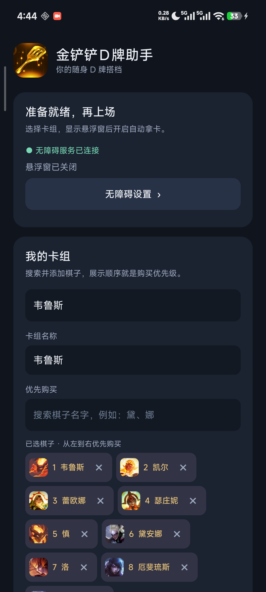
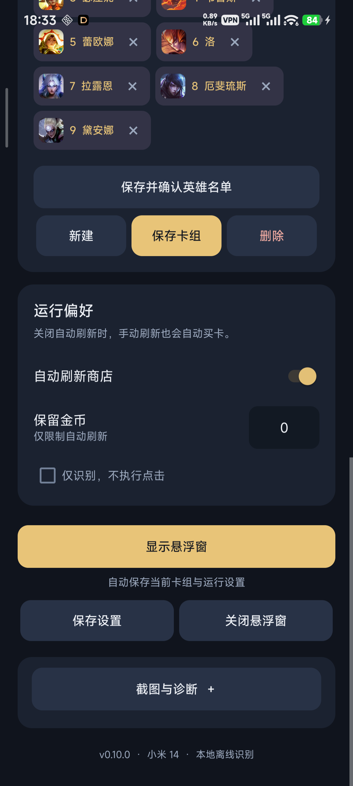
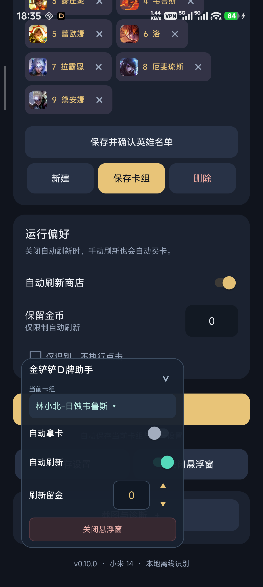

# 金铲铲D牌助手
> **免责声明**
>
> 本项目用于个人阵容整理、阵容管理及无障碍交互研究。请遵守游戏与平台规则，仅在允许的环境中使用，不得用于破坏公平竞技、干扰其他玩家或获取不当竞争优势。
>
> 本项目通过屏幕识别与系统触摸接口工作，不直接修改游戏客户端、内存或服务端数据。自动点击仍会触发游戏内正常的购买、刷新、收藏替换与阵容应用，相关金币、棋子及收藏状态会随这些操作正常变化。使用前请了解并确认具体功能及操作范围。

基于 Android 无障碍截图、离线中文 OCR 和手势点击的金铲铲商店辅助。保存目标卡组后，在游戏中通过悬浮窗开启自动拿卡，也可选择自动刷新。

**当前源码：v0.10.0 测试版；已发布 APK：v0.9.5** · **实机适配：小米 14 / 2670 × 1200 横屏** · **识别在手机本地完成**

[下载 APK](https://github.com/pengmaochang/jinchanchan-helper/releases/latest) · [开发与测试](docs/DEVELOPMENT.md) · [更新记录](docs/CHANGELOG.md) · [素材与依赖说明](THIRD_PARTY_NOTICES.md)

## 界面预览

以下为 v0.9.5 实机截图，悬浮面板截图中的自动拿卡、自动刷新均处于关闭状态。

| 首页与卡组 | 运行设置 | 悬浮控制面板 |
| --- | --- | --- |
|  |  |  |

## 功能

- **搜索选卡**：输入部分中文卡名，点选候选即可加入展示区；棋子显示头像、优先级编号和移除按钮 `×`。
- **保存卡组**：最多保存 200 套，每套最多 20 个目标。阵容名称最长 80 字符，名字相同的棋子不会重复加入。
- **按优先级购买**：按标签编号分配金币；相同目标在多个卡位出现时按从左到右的顺序购买，可一次派发批量点击。
- **两种刷新模式**：关闭自动刷新时，由你手动刷新、助手购买；开启后，助手在目标购买完并确认商店状态后继续刷新。
- **刷新留金**：保留金币只限制自动刷新，不限制目标卡购买。支持直接输入及 `0 / 10 / 20 / 30 / 40 / 50 / 60 / 80 / 100` 快捷档位。
- **悬浮控制**：半透明金铲子图标显示开/停状态；点击展开面板，点面板外收起；可拖动、切卡组、修改留金或关闭悬浮窗。
- **识别与排查**：提供仅识别模式、延迟单次截图、最近截图预览和本地滚动诊断。

## 阵容码管理（v0.10.0 测试版）

可一次粘贴多套完整阵容码，自动提取并显示名称。例如下面的代码会显示为“林小北-日蚀卡尔玛”：

```text
【阵容码】#林小北-日蚀卡尔玛#MjE5OTY5MDM5MDAxMzM4NDQxNzkyMDMyNDk3MDQ3
```

- **首次开启**：如果当前选中的是尚未解析的阵容码，开启自动拿卡时会先导入一次，自动收起面板，完成后按识别出的英雄继续拿卡。已经解析的阵容不会因为开启拿卡反复导入。
- **切换阵容**：在悬浮窗选中阵容码时复制完整代码并发起导入；首页也提供“在游戏中导入”按钮。
- **商店处理**：商店展开时先点击右下角总金币按钮收起，确认后打开游戏阵容面板。
- **收藏替换**：收藏满时只点击**第三套收藏**的替换按钮，随后核对第三套的名称、英雄和应用状态；不会把第一套的“取消”误认为第三套已应用。
- **本地预览**：每次成功导入更新名称和英雄所在行，裁到应用按钮之前，并去掉英雄末尾的多余空白；若“收藏成功”提示遮挡预览区域，则等待提示消失。
- **英雄名单**：从头像匹配随包棋子目录。识别不完整时需要在助手补齐并点击“保存并确认英雄名单”，才允许自动拿卡。手动确认的购买名单在重新生成预览时保留。
- **停止操作**：关闭悬浮窗可取消导入。导入期间买卡与刷新循环暂停，离开游戏或展开面板时不会继续点击游戏。

已验证阵容码解析、第三行头像、按钮坐标、重复名称选择和截取范围。实机已完成第三套替换、应用及紧凑预览更新，用户已确认新图片正常展示；长时间稳定性仍需持续验证。当前重点适配提供截图中的三套收藏界面；遇到未知布局或无法核对目标时停止，不盲点其他收藏。

## 安装

1. 打开 [Releases](https://github.com/pengmaochang/jinchanchan-helper/releases)，下载 `JccDHelper-v0.9.5.apk`。校验值见同一 Release 的 `SHA256SUMS.txt`。
2. 在手机安装 APK，打开 **金铲铲D牌助手**。
3. 点“无障碍设置”，在系统中启用本应用的无障碍服务。部分系统需要先允许安装来源或受限设置，请以手机实际提示为准。
4. 回到助手，确认服务状态显示“已连接”。更新或系统清理进程后，可能需要重新绑定服务。

当前发布包是开发签名包。覆盖安装需要使用相同签名；自行在另一台电脑生成的签名不一定能覆盖原安装。

## 配置第一套卡组

1. 选择“＋ 新建卡组”，填写名称，例如“五费优先”。
2. 在“优先购买”下输入部分中文名字，例如“黛”，点选搜索结果。
3. 已选择棋子会显示为头像标签。**编号从小到大就是购买优先级**；点击标签右侧 `×` 移除。重新添加的棋子排在最后。
4. 点击“保存卡组”。之后可以从首页下拉框或悬浮面板直接切换已保存的卡组。
5. 最后一套卡组不能删除；删除其他卡组前会弹窗确认。

搜索使用随 APK 打包的 S18 棋子目录与头像，选卡时无需联网。旧版本保存的名字按原顺序保留，即使某个名字不在当前目录中也不会被自动删除。

## 运行方式

1. 设置是否自动刷新、保留金币以及是否仅识别。
2. 点击“显示悬浮窗”。此按钮会保存当前卡组及运行设置。
3. 切回游戏，点金铲子图标展开面板，开启“自动拿卡”。
4. **点面板外收起**。展开面板期间暂停派发游戏点击，收起后继续待命。
5. 手动打开商店；助手在商店打开时处理目标，收起商店后等待下一次打开。
6. 结束时关闭“自动拿卡”，或点击面板底部“关闭悬浮窗”。关闭悬浮窗会同时停止自动操作并移除图标。

“开”表示辅助处于待命状态，不代表任何界面都在点击。离开游戏、进入不匹配的画面或商店关闭时都会等待。

### 自动刷新与手动刷新

| 设置 | 行为 |
| --- | --- |
| 自动拿卡关 | 不执行自动购买或刷新 |
| 自动拿卡开、自动刷新关 | 你负责刷新，助手识别并购买目标 |
| 自动拿卡开、自动刷新开 | 购买目标后确认结果，没有目标且满足留金要求时自动刷新 |
| 仅识别开 | 输出识别状态，不派发购买或刷新 |

### 保留金币的准确含义

**保留金币只限制自动刷新。目标卡只要买得起，就会购买。**

自动刷新每次按 2 金币计算，只有 `当前金币 − 2 ≥ 保留金币` 时才允许刷新。购买按当前实际金币分配预算，不会因为保留值较高而拒绝购买，也不会超出当前金币连续购买。

| 当前金币 | 保留金币 | 操作 | 结果 |
| --- | --- | --- | --- |
| 11 | 60 | 买 1 费蕾欧娜和 1 费洛 | 允许，买完剩 9 |
| 11 | 60 | 自动刷新 | 不允许 |
| 62 | 60 | 自动刷新 | 允许，刷新后剩 60 |
| 61 | 60 | 自动刷新 | 不允许 |
| 4 | 60 | 买 5 费目标 | 金币不足，等待 |

新配置默认保留 50，已有保存值沿用。悬浮输入范围为 0～999，上下按钮在预设档位间移动，边界不循环；如手动输入 55，向上到 60、向下到 50。

## 刷新与购买的时序

为避免“识别到上一轮的卡，却点中下一轮同位置”的问题，v0.9.4 起采用串行控制：

1. 动作派发前登记，旧识别结果作废；同一时间只允许一个手势。
2. 手势执行期间不开始下一轮自动截图。
3. 刷新手势完成后，至少等待 350ms 再取帧；购买手势完成后至少等待 100ms。
4. 刷新后的完整商店需要连续两帧名字、费用和位置一致，再允许拿卡。**仅扣金币不能证明新卡面已就绪。**
5. 下一次自动刷新也需要当前卡面稳定。回调超时会暂停，不重放不确定的旧动作。

批量点击使用 20～26ms 按压、3～5ms 间隔，五张卡的**输入排程**不超过 150ms。这个数字不包含截图、OCR、画面确认和游戏处理，不能当作整轮拿卡时间。Android 无障碍截图间隔约 333ms 是当前实现的重要速度限制。

## 识别与适配范围

- 当前仅验证小米 14 的 **2670 × 1200 原始横屏画面**；其他分辨率、UI 比例或商店布局需要重新标定。
- 在刷新文字附近定位水平偏移，再同步调整卡名、费用、金币区域与点击位置。已验证原布局及约 **−45 像素**偏移布局。
- 用一张拼接图批量读取五个卡名、费用、金币和刷新文字；使用随包中文模型。
- 六个有人工标注参考图的名字有字形模板快速路径；其他名字仍由 OCR 识别。
- 棋子目录用于搜索选卡和缺失费用恢复。**当前尚未实现通用的全卡池模糊纠错与常见错字自动学习。** OCR 错字仍可能导致漏买。
- 名字没读到的非空卡位与真正空位分开处理。未知卡位会阻止自动刷新；能明确识别的其他目标仍可能购买。
- 若刷新后五张卡恰好完全相同，又没有捕获到中间空白转场，助手会继续等新画面。这时可先暂停，再确认商店并重新开启。
- 已有自动回归不能代替长时间实战验证，完整卡池准确率、不同设备兼容性及真实错买率仍待测量。

## 常见问题

| 现象 | 检查方法 |
| --- | --- |
| 图标显示“开”，但没有动作 | 检查商店是否打开、是否在游戏前台、面板是否已经收起 |
| 自动刷新停止 | 检查刷新开关和留金值；刷新后余额必须不低于留金 |
| 有目标卡不购买 | 检查当前卡组、仅识别开关、实际金币、OCR 输出；保留金币不会限制购买 |
| 一直等新卡面稳定 | 可能处于动画、卡位读不全、字段反复变化或未确认刷新结果；先暂停，保留诊断再检查 |
| 一直等待打开商店 | 检查横屏分辨率和 UI 偏移；查看诊断中的 `shop` 与 `offset_x` |
| 更新后服务未连接 | 在系统中重新启用服务，或开发时运行仅恢复已有授权的绑定脚本 |
| 开始了却没有点击 | 确认“仅识别”未勾选，并收起展开的面板 |
| 为什么刷新比旧版稍慢 | 需要等待新卡面稳定并防止动作重叠；不再依靠扣金币立即进入下一轮 |

## 本地数据与权限

应用使用 `AccessibilityService.takeScreenshot` 获取画面、`dispatchGesture` 派发触摸，通过窗口包名检查游戏前台。服务配置声明了截图、手势和读取窗口内容能力，需由用户在系统中授权。

中文 OCR 模型随 APK 打包，合并后的清单移除了 `INTERNET` 权限。识别画面不上传；卡组与设置保存在应用私有 `SharedPreferences`。普通商店识别不保存截图；阵容导入成功后会在应用私有目录更新裁剪后的预览。只有手动延迟截图会保存到相册 `Pictures/JccProbe/` 及应用内最近截图文件。

本地文本诊断为 `files/assist-trace.log`、`files/assist-trace.previous.log`，各约 256 KiB，记录卡名、金币、等待原因、阶段和耗时，不包含截图。公开反馈日志前请自行检查是否含有不想公开的信息。

## 从源码构建

本项目本地工作目录为 `D:\code\jinchanchan-helper`。仓库中不包含 SDK、JDK、Gradle 缓存、签名私钥、个人设置和调试原图。

环境：Windows、Python 3.8+、完整 JDK 17、Gradle 8.9、Android SDK 35 / Build Tools 35.0.0。当前构建目标 `minSdk 30`、`targetSdk 35`，只打包 `arm64-v8a`。

```powershell
git clone https://github.com/pengmaochang/jinchanchan-helper.git
cd jinchanchan-helper
python tools/prepare_build.py
python tools/build_apk.py
```

准备脚本下载并校验便携 JDK、Gradle、Android 平台和 Build Tools；首次解析 Maven 依赖需要网络。构建输出为 `dist/JccScreenshotProbe.apk`，脚本会执行 APK 签名验证。完整环境说明、ADB、测试与样本准备见 [开发文档](docs/DEVELOPMENT.md)。

如需覆盖现有安装，应保留自己原来的 `.tools/probe-debug.jks`。首次构建会创建本机开发签名文件，**不要提交此文件**。

## 项目结构

```text
app/src/main/
  AndroidManifest.xml             权限、入口和服务声明
  java/local/jcc/probe/
    MainActivity.java             卡组与运行设置界面
    CardPicker.java               搜索候选、头像标签与移除
    DeckStore.java                卡组保存、选择和迁移
    CaptureService.java           截图、工作线程、动作调度与诊断
    ShopOcr.java                   区域裁剪、批量 OCR、模板与缓存
    BuyPolicy.java                购买优先级、预算和确认状态机
    ShopActionGate.java           手势互斥与渲染等待
    ScanOverlay.java              图标、面板、开关和刷新留金
    PhoneLayout.java              原生坐标与水平偏移定位
  assets/                         S18 目录、头像和字形模板
tools/                            构建、验证、模板准备与日志工具
docs/                             开发文档、更新记录和说明截图
```

## 数据与素材

S18 棋子目录来自 [金铲铲大数据](https://www.dataj.cc/explorer) 使用的公开目录接口。该站并非游戏官方数据来源；随包数据包含按名字去重后的可见条目及部分商店相关变体，不宣称官方完整性。头像与金铲子原始美术素材属于相应权利人。

依赖版本、图标来源和第三方说明见 [THIRD_PARTY_NOTICES.md](THIRD_PARTY_NOTICES.md)。本项目与游戏官方无隶属关系。
