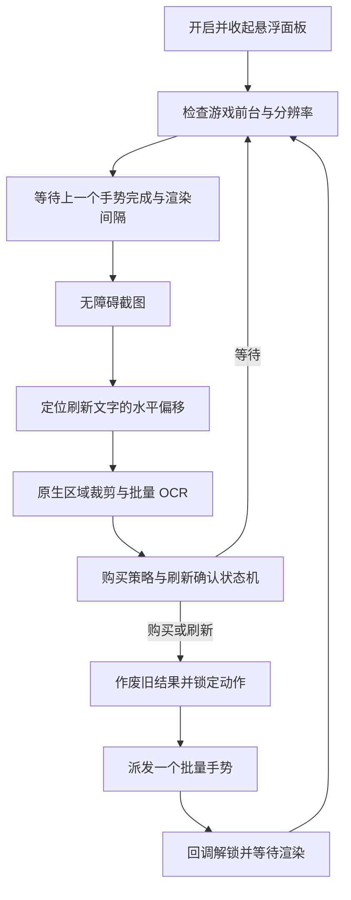

# 开发与测试

本文对应 v0.9.5。当前本机目录为 `D:\code\jinchanchan-helper`，Android 包名为 `local.jcc.probe`。

## 工具准备

```powershell
python tools/prepare_build.py
python tools/build_apk.py
```

脚本将便携工具放在 `.tools/`。需要完整 JDK 17（含 `jlink`），不支持仅带 `java` 的精简运行时。可用 `PROBE_JAVA_HOME` 指定完整 JDK，用 `ANDROID_HOME` 指定 SDK。

ADB 可单独从 [Android 官方 Platform Tools](https://developer.android.com/tools/releases/platform-tools) 获取，解压至 `.tools/platform-tools/`，或使用自己的 SDK 中的 ADB。小米手机需要开启 USB 调试；安装和通过 ADB 模拟输入可能受手机的额外调试设置影响。以手机确认提示为准。

```powershell
& .tools/platform-tools/adb.exe devices
& .tools/platform-tools/adb.exe -d install -r dist/JccScreenshotProbe.apk
& .tools/platform-tools/adb.exe -d shell am start -n local.jcc.probe/.MainActivity
```

`-d` 适用于只连接一台 USB 设备；多设备请换成 `-s <serial>`。运行时不需要 PC 持续连接，截图、OCR 和手势均在手机执行。

## 处理流程



截图初始间隔 334ms；发生系统截图频率错误后会轻微上调。派发时画面年龄上限为 250ms，避免使用耗时很久的旧结果。刷新后额外等待 350ms、购买后 100ms；这些等待与截图间隔共同决定实际吞吐。

## 原生识别区域

所有数值为 2670×1200 原图像素。下表是基础布局；运行时将定位出的 `offsetX` 同时加到裁剪及点击的 X 坐标上。

| 区域 | 左上角 | 宽 × 高 |
| --- | --- | --- |
| 第 1 格卡名 | 488, 489 | 274 × 55 |
| 第 2 格卡名 | 918, 489 | 274 × 55 |
| 第 3 格卡名 | 1348, 489 | 274 × 55 |
| 第 4 格卡名 | 1777, 489 | 274 × 55 |
| 第 5 格卡名 | 2207, 489 | 274 × 55 |
| 各格费用 | 对应卡名 X + 350, 489 | 35 × 57 |
| 金币 | 2470, 1029 | 112 × 76 |
| 刷新文字 | 2444, 793 | 107 × 57 |

`PhoneLayout.locateOffset` 在刷新区域水平 ±96 像素附近选取候选原点；它只调整裁剪位置，之后仍由 OCR/模板检查商店是否打开。实机已验证偏移 0 与约 −45。

OCR 输入为原生像素裁剪，不缩放成低分辨率参考图。一次批量识别五个名字、五个费用、金币与刷新字样。白字掩码另用于模板与缓存签名；有效完整帧缓存最长 1.2 秒，等待过久可请求绕过缓存恢复。

## 纯 Java 回归

```powershell
$probeJdk = (Get-ChildItem .tools/jdk17 -Directory | Select-Object -First 1).FullName
& "$probeJdk/bin/javac.exe" -encoding UTF-8 -d .tools/checks `
  app/src/main/java/local/jcc/probe/BuyPolicy.java `
  app/src/main/java/local/jcc/probe/ShopActionGate.java `
  app/src/main/java/local/jcc/probe/TapTiming.java `
  app/src/main/java/local/jcc/probe/GoldReserve.java `
  tools/PolicyCheck.java tools/ActionGateCheck.java tools/TimingCheck.java tools/ReserveCheck.java
& "$probeJdk/bin/java.exe" -cp .tools/checks PolicyCheck
& "$probeJdk/bin/java.exe" -cp .tools/checks local.jcc.probe.ActionGateCheck
& "$probeJdk/bin/java.exe" -cp .tools/checks TimingCheck
& "$probeJdk/bin/java.exe" -cp .tools/checks local.jcc.probe.ReserveCheck
```

| 检查 | 核心场景 |
| --- | --- |
| PolicyCheck | 目标优先级、部分购买、实际金币预算、留金仅限制刷新、刷新前后稳定卡面、过渡目标不被重放 |
| ActionGateCheck | 一个动作期间禁止另一个动作、完成后的等待、旧回调不能解锁新动作 |
| TimingCheck | 1～5 个按压不重叠，单次 20～26ms，五张输入排程 ≤150ms |
| ReserveCheck | 默认值 50、预设上下切换、自定义值及边界不循环 |
| VisionSpeedCheck | 位运算字形匹配与参考实现等价，含跨 64 位字边界 |

## Android 只读样本回归

```powershell
& .tools/platform-tools/adb.exe -d shell am instrument -w local.jcc.probe/.DeckChecks
& .tools/platform-tools/adb.exe -d shell am instrument -w local.jcc.probe/.OcrChecks
& ./tools/rebind_service.ps1
```

`DeckChecks` 使用独立测试设置文件，验证迁移、保存、编辑、选择、删除和最后一套保护。`OcrChecks` 只读取图片、验证 OCR 和购买决策，不派发手势。原始测试截图未公开打包；没有样本时 OCR 回归会报告缺少文件，不能把这个结果当作识别失败。

| 样本 | 位置 | 内容 |
| --- | --- | --- |
| fixture0.jpg | 应用 external files | 原始收起商店 |
| fixture1.jpg | 应用 external files | 原始商店、金币 74 |
| fixture2.jpg | 应用 external files | 购买后首格空位、金币 73 |
| fixture3.png | 应用 external files | 卡蜜尔等现场样本、金币 31 |
| fixture4.jpg | 应用 external files，可选 | 黛安娜样本、金币 28 |
| fixture5.png | 应用 private files，可选 | 新横屏方向的收起商店 |
| fixture6.png | 应用 private files，可选 | 偏移 −45 的商店、金币 97 |

测试代码还会模拟非空但未读出的卡名、缺失费用和缓存恢复。通过标准为 `INSTRUMENTATION_RESULT: result=PASS`。`am instrument` 常使被测进程和无障碍连接重建；`rebind_service.ps1` 只断开并恢复原本已经授权的助手服务，保留其他服务，且恢复后默认暂停。原授权不存在时脚本拒绝添加授权。

## 现场诊断

```powershell
& .tools/platform-tools/adb.exe -d shell run-as local.jcc.probe cat files/assist-trace.log
& .tools/platform-tools/adb.exe -d shell run-as local.jcc.probe cat files/assist-trace.previous.log
& .tools/platform-tools/adb.exe -d logcat -d -s JccPerf:I JccAssist:I AndroidRuntime:E
```

重点字段：`action`、`reason`、`shop`、`readable`、`offset_x`、`frame_ms`、`ocr_ms`，以及 `dispatch/completed/cancelled` 的动作 ID。对错买问题，检查是否等到新卡面稳定，是否出现多个未完成动作，或在手动操作期间卡面改变。

截图可以用于标定，但公开反馈应只保留相关区域；请不要上传签名文件、账号页面、完整个人配置或包含其他应用内容的截图。

## 当前验证边界

已跑过原生截图、偏移截图、费用缺失、部分卡名失败、预算与时序回归；这些样本不是全卡池准确率测试。手机回归中变化帧 OCR 曾测得约 162ms 中位数、209ms 最大值，同画面缓存约 13ms；这是一次样本运行，不是稳定性能承诺。CPU 温度、前后台状态、动画和系统回调均会改变耗时。

项目里的 S18 目录目前没有作为通用 OCR 模糊纠错字典使用。后续可在保留歧义处理和回归样本的前提下实现全卡池名字归一化与错字记录。

## 仓库与本地文件

公开仓库只上传代码、目录/头像、模板、文档和经过选择的说明截图。`.tools/`、`.gradle/`、构建目录、`dist/`、`captures/` 与 `local.properties` 被忽略。签名文件放在 `.tools/probe-debug.jks`；不要将真实私钥改为受版本控制的文件。

## 阵容码导入测试（v0.10.0）

`LineupCodeCheck` 验证名称提取、批量去重、非法输入及长标题单字 OCR 容错；`LineupFlowCheck` 验证商店收起、替换第三套、应用状态确认和旧界面等待。`PortraitCheck` 接收本地原图路径和可选行号 0/2，用随包头像验证对应行识别。

Android `LineupChecks` 使用应用 private files 中的 `lineup-fixture-list.jpg`、`lineup-fixture-replace.jpg`、`lineup-fixture-applied.jpg`、`lineup-fixture-board.jpg`，回放用户提供的四张原始截图；原图不公开打包。检查第三套按钮、第三行头像、第一套取消按钮不能干扰第三套、同名第一/第三套选择、紧凑截图和收藏成功遮挡。它不派发游戏手势，存储检查只用隔离的 `lineup_checks_only` 设置。

导入保存的预览位于应用 private `files/lineups/`，新版本使用 `-row3.png` 后缀，旧的首行预览在下一次明确导入时更新。`LineupImporter`、`LineupFlow`、`LineupVision` 管理独立流程，复用同一个手势互斥门；普通购买循环在导入活动期间不运行。
